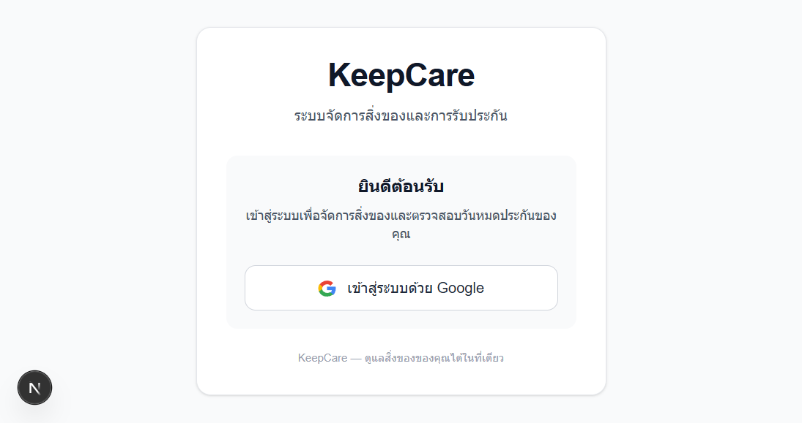

# KeepCare

ระบบจัดการสิ่งของและการรับประกัน ช่วยให้ติดตามข้อมูลสิ่งของและวันหมดประกันได้ในที่เดียว

## ภาพหน้าจอ



## GitHub

[ดู source code บน GitHub](https://github.com/fake141213/Keepcare)

## เริ่มต้นใช้งาน

ติดตั้ง dependencies:

```bash
npm install
```

ตั้งค่าตัวแปรแวดล้อมที่จำเป็นในไฟล์ `.env` จากนั้นเริ่ม development server:

```bash
npm run dev
```

เปิด [http://localhost:3000](http://localhost:3000) เพื่อใช้งานระบบ

## อัปโหลดโปรเจกต์ขึ้น GitHub

```bash
git remote add origin https://github.com/fake141213/Keepcare.git
git branch -M main
git push -u origin main
```
